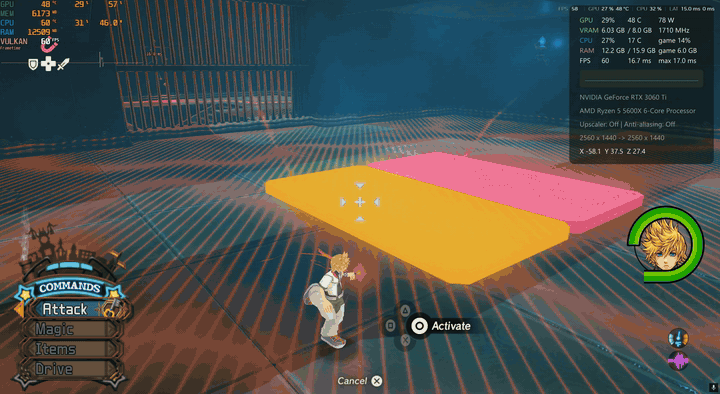
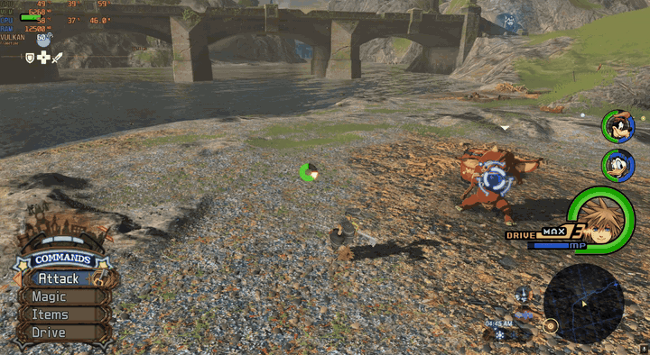
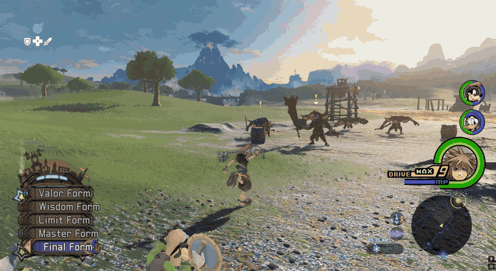
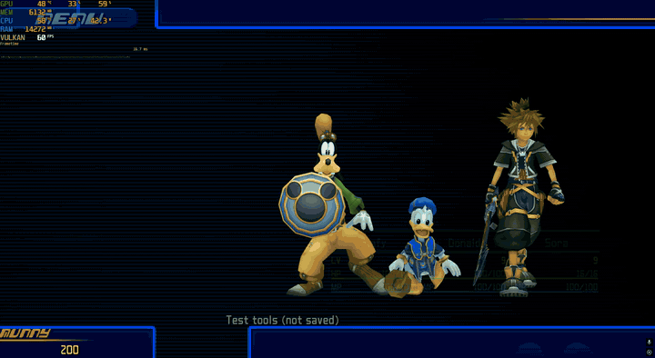

# Legend of Kairi

> [!WARNING]
> **Early alpha:** bugs and crashes are likely. Back up your Savage Wind saves (`Savage Wind/save`) before you play.
> **0.2.5-alpha plays on your own.** Co-op is in 0.1.4-alpha only for now (see [Which version do I need?](#which-version-do-i-need)).

Play **The Legend of Zelda: Breath of the Wild** (on the [Savage Wind](https://github.com/Revivedx/SavageWindRecomp) PC
recompilation) as **Sora from Kingdom Hearts II Final Mix**, with Roxas, Mickey, Donald and Goofy, KH2's combos,
magic, Drive Forms and summons, and KH2's own menus and HUD.

> Unofficial fan mod. Not affiliated with Nintendo, Square Enix or Disney.
> **No game files are included.** The installer builds Sora, the party, the effects, sounds, HUD and logos on your PC
> from *your own* copies of Breath of the Wild and Kingdom Hearts II.

## Features

- Sora's KH2 ground and air combos and finishers, in BotW's world (climbing, gliding, swimming)
- KH2 magic (Fire, Blizzard, Thunder, Cure, Magnet, Reflect) with KH2's own effects and sounds
- Drive Forms: Valor, Wisdom, Limit, Master, Final and Anti

- Summons: Chicken Little, Genie and Peter Pan, unlocked by BotW milestones
- Donald and Goofy fight next to you; Mickey comes to the rescue in boss fights
- Play as Roxas until Sora wakes up
- More Keyblades, and Sora and Roxas can still hold BotW's weapons
- Every KH2 Keyblade has its own hit sound, hit reach, swing whoosh and wall clank
- Four Keyblades of our own, inspired by Breath of the Wild: the Sealing Blade (pull the Master Sword), the Guardian
  Core (activate the Great Plateau Tower), the Silent Princess (find Zelda's Silent Princess memory) and Calamity's
  Gaze (free all four Divine Beasts)
- Explosive barrels blow up when Sora hits them with the Keyblade, Fire or Thunder; Sora lifts, carries and throws
  barrels, rocks and pots like Link
- Sora shoots Link's bow: he takes Link's pose and holds the bow and arrow
- Throw the Keyblade (hold Triangle + R1, let go of R1): it flies where the camera looks and comes back to Sora's
  hand, with gyro aim on a controller that has a gyro (turn on Savage Wind's *Controls > Mouse camera* for it)
- Sora throws BotW's weapons like Link (Triangle + R1), and holds and swings boomerangs and the Lizalfos Arm
- KH2's battle stance while enemies are close
- Debug Menu: Roxas, Kairi and a Green Tunic as looks for Sora (Outfit row, right after Timeless River)
- Debug Menu: Riku, Auron, Mulan, Aladdin, Jack Sparrow and Cloud can take Donald's or Goofy's place
- KH2's damage formula, levels, EXP, abilities, prize orbs and munny
- KH2's command menu, shortcuts, HP / MP / Drive gauges and Equipment menu drawn in BotW
- Skateboards in front of the Great Plateau shrines
- KAIRI title and loading screen logos
- Co-op multiplayer for up to 4 players, in 0.1.4-alpha (see [Multiplayer](#multiplayer))

## Which version do I need?

| You want to | Legend of Kairi | Savage Wind |
|---|---|---|
| Play on your own (newest) | **0.2.5-alpha** | **0.6.0-alpha.6** (a 0.5.3-alpha.5 folder is upgraded for you) |
| Play co-op with friends (up to 4) | **[0.1.4-alpha](https://github.com/tvllerr/legend-of-kairi/releases/tag/v0.1.4-alpha)** | **0.4.1-alpha.4** |

Co-op is not in 0.2.5-alpha yet. Everybody in a co-op game needs the very same release, so co-op players stay on 0.1.4.

## Requirements

- Windows 10 or 11 (64-bit), about 15 GB of free disk space during the install
- **[Savage Wind 0.6.0-alpha.6](https://github.com/Revivedx/SavageWindRecomp/releases/tag/v0.6.0-alpha.6)** (this
  version only), set up with your own Breath of the Wild 1.9.0 game files: start it once before installing. Still on
  Savage Wind 0.5.3-alpha.5 from Legend of Kairi 0.1.10? The installer brings that folder up to 0.6.0 for you.
  NVIDIA's DLSS file is not included, and the installer does not download it.
- **KINGDOM HEARTS HD 1.5+2.5 ReMIX** on Steam, **without KH2 mods installed**. The installer checks every KH2 file it
  reads: if you have a KH2 mod in the `.pkg` files, restore the originals or use Steam's *Verify integrity of game files*.

## Install

1. Download `Legend-of-Kairi-0.2.5-alpha.zip` from [Releases](https://github.com/tvllerr/legend-of-kairi/releases/latest).
2. Right-click it > **Extract All...** into an empty folder (not inside the Savage Wind folder).
3. Double-click **Install Legend of Kairi.cmd**.
4. Click **Choose...** next to *Savage Wind folder* and pick the `Savage Wind` folder (the one with `extracted` inside).
   Kingdom Hearts is found automatically from Steam.
5. Click **Install** and wait for the finish screen (about 15 minutes).

**Updating:** double-click **Update Legend of Kairi.bat** in your install folder: it fetches the newest release, checks
its signature and opens the installer on Update. Your saves are kept.

The update from 0.2.4 to 0.2.5 leaves your Savage Wind folder as it is. On Windows it builds Sora's data again with KH2's
own poses (about 10-15 minutes); on the Steam Deck it takes a few seconds.

The update from 0.2.3 to 0.2.4 leaves your Savage Wind folder as it is. On Windows it builds Sora's data again (about
20-25 minutes); on the Steam Deck it takes a few seconds. Let it finish: the game can not start until the update is done.

The update from 0.2.2 to 0.2.3 leaves your Savage Wind folder as it is and builds Sora's data again from the start (about
20-25 minutes, like a new install: new chest motions, footsteps and splashes). Let it finish: the game can not start until
the update is done.

The update from 0.2.1 or 0.2.0 to 0.2.2 leaves your Savage Wind folder as it is and builds Sora's data again from the
start (about 15 minutes, like a new install: the installer's build tools changed). Let it finish: the game can not start
until the update is done.

The update from 0.1.10 is a big one: it brings your Savage Wind 0.5.3 folder up to 0.6.0-alpha.6 where it is
(it downloads the official Savage Wind 0.6.0-alpha.6 zip and keeps your game files, saves and settings; Savage Wind's
own setup then runs for about 7 minutes), and it builds Sora's data again (about 15 minutes more). Let it finish: the
game can not start between the Savage Wind upgrade and the end of the update. If you play co-op, don't update: stay on
0.1.4.

If Savage Wind later updates itself past 0.6.0-alpha.6, the launcher tells you: wait for a Legend of Kairi release for
that version, or unzip Savage Wind 0.6.0-alpha.6 over it again and run the installer.

## Play

- **Solo:** double-click **Play Legend of Kairi.bat**.
- Only one copy of the game can run at a time on one PC.
- **BotW's button prompts (enter a shrine, open a chest, talk, pick up):** press **Triangle** on a PlayStation pad
  (Y on Xbox, X on Switch) or **Space** on the keyboard. In Sora mode Circle / E is the attack.

## Multiplayer

> [!NOTE]
> Multiplayer is in **0.1.4-alpha** only (with Savage Wind 0.4.1-alpha.4); 0.2.5-alpha has no Multiplayer launcher.
> Multiplayer works, but it is still glitchy and needs more development: enemy positions and copied enemy attacks can be
> late or out of sync, and a hit may not land now and then. Please report what you see.

- Every player needs this **exact same release** (0.1.1 to 0.1.4 play together; 0.1.0 can't join them).
- Players connect directly over UDP port 7790. Easiest: everyone installs [Tailscale](https://tailscale.com) and joins
  the same tailnet.
- Right-click **Play Legend of Kairi Multiplayer.bat** > **Edit**. On the `set PEERS` line, replace
  `FILL-IN-FRIENDS-TAILSCALE-IP` with your friend's Tailscale IP (up to 3 friends, separated by commas, each with
  `:7790`). Save it, then double-click it.
- Synced: players, Drive Forms and effects, skateboards, ragdolls, shared enemy health and deaths, enemies moving and
  attacking the same.

## Steam Deck / Linux

A native Linux build is on the [0.2.5-alpha release](https://github.com/tvllerr/legend-of-kairi/releases/tag/v0.2.5-alpha):
`Legend-of-Kairi-0.2.5-alpha-linux-x86_64.tar.gz`. Single player, Savage Wind 0.6.0-alpha.6. **No Windows PC needed:**
it builds the mod's data on the Deck itself.

- **You need:** your own BotW 1.9.0 game files (a folder with `exefs/` and `romfs/`), the Steam KINGDOM HEARTS HD
  1.5+2.5 ReMIX on the Deck **unmodded** (a KH2 mod that changed the `kh2_*.pkg` files is refused; your KH2 folder is
  only read), a Steam Proton (Proton 11.0: it runs one Windows tool of the data build, the game itself needs no Proton)
  and about 30 GB free.
- **Install (Desktop Mode):** unpack the `.tar.gz`, open a terminal in that folder and run `./install.sh`. It finds your
  Steam KH2 and Proton, asks for the BotW folder, downloads the stock Savage Wind 0.6.0-alpha.6 AppImage (checked), sets
  the game files up (10-20 minutes the first time), builds the mod's data (about 20-25 minutes: keep the Deck plugged
  in) and checks every file. It installs into `~/LegendOfKairi`. Stopped half-way? Run it again: it goes on.
- **Steam:** Steam > Games > *Add a Non-Steam Game to My Library* > Browse > `~/LegendOfKairi/kairi.sh` (no Proton /
  compatibility tool). Then play it from Game Mode. Always start it through Steam (a game started outside Steam gets no
  controller input in Game Mode).
- **Update (from Linux 0.2.2 or 0.2.1):** run `~/LegendOfKairi/update.sh` (it checks the author's signature, keeps saves and
  settings, builds the new data; 0.2.1 keeps working until the new data is built and checked).
- Built and checked on a Steam Deck; other Linux PCs are not proven yet.
- Saves and settings: `~/LegendOfKairi/sw/save/` and `~/LegendOfKairi/sw/savagewind.ini`. Full steps: `README-DECK.md`
  in the package.

## Troubleshooting

- **Something wrong? Make a bug report:** close the game, double-click **Make bug report.bat** (next to the Play
  launchers). A `Legend of Kairi bug report <date>.zip` appears on your Desktop: send it to tvllerr (a GitHub issue
  here or a message on Twitter) with what you saw. It holds the logs, launchers, `savagewind.ini` and system info
  (Windows, graphics card, RAM); no saves, no game files, friends' IPs removed.
- **Sora / Roxas invisible:** if the model can't be drawn, a short line in the bottom-left corner says why. A
  screenshot of it plus the bug report zip is all we need. (0.1.0-0.1.2 didn't draw them on AMD and Intel graphics:
  update to 0.1.3.)
- **"files are incomplete" / "from another version" when starting:** run Install Legend of Kairi.cmd and choose Update.
- **"your KH2 files differ from the Steam KH2 FM release"**: a KH2 mod is installed. Restore the original `.pkg` / `.hed`
  files or run Steam's *Verify integrity of game files*, then install again.
- **0.2.1's install stopped at "Check every file"** with 53 model files listed (`forms/anti_model.bin`,
  `chicken_model.bin`...): fixed in 0.2.2. Unzip 0.2.2 into a new empty folder and install from there (same Savage Wind
  folder; saves are kept, they live in the Savage Wind folder).
- **The install stopped:** the install window shows the step and has **Open logs**. Send the `work/logs` folder to tvllerr.
- **The game misbehaves:** the game's log is in `logs/last.log` next to the launchers (the run before is `prev.log`).

## Download check

`Legend-of-Kairi-0.2.5-alpha.zip` sha256: `0cd17d20b7b7f67a803a882357f37fb519e12d57d5ab4b63557aa89633177876`

`Legend-of-Kairi-0.2.5-alpha-linux-x86_64.tar.gz` (Steam Deck / Linux) sha256:
`c20ff188085bb482495329887c20a3103264b476e64e76f0aecf04a5c00bf41d`

`Legend-of-Kairi-0.2.4-alpha.zip` sha256: `fc2a5fa64b571eab571dab665f7179e9a1aa1ed893e69540a91824a049ee04a5`

`Legend-of-Kairi-0.2.4-alpha-linux-x86_64.tar.gz` (Steam Deck / Linux) sha256:
`7954575eb8f2c4aeecd781b9487a12dae7c717f0d3aa20a4eabcda0bde497ce6`

`Legend-of-Kairi-0.2.3-alpha.zip` sha256: `d37a0be567c26a9df37516f47b48607bdcc83b82977d6f56b2dfe1870c1f97d9`

`Legend-of-Kairi-0.2.3-alpha-linux-x86_64.tar.gz` (Steam Deck / Linux) sha256:
`7d8e2dad5d0901ee81321860ddbd654a21b55a2689c30d0ceadc8831ba7971a3`

`Legend-of-Kairi-0.2.2-alpha.zip` sha256: `984908a58e0f7d80851fa29514510cacb703ef4b9615781481b03fd4116cb078`

`Legend-of-Kairi-0.2.2-alpha-linux-x86_64.tar.gz` (Steam Deck / Linux) sha256:
`71cbe8681d7ec350eb5fc8046243ba02ab1f48d04ab7b68a5ece0b05e9eccc95`

`Legend-of-Kairi-0.2.1-alpha.zip` sha256: `50c3677ef258869d7451f7498385b34034a973bbcd5f711274ac6897972adea6`

`Legend-of-Kairi-0.2.1-alpha-linux-x86_64.tar.gz` (Steam Deck / Linux) sha256:
`e4af99553e93c0193c43840f794c876b40e97ea755d918dbfb12b2605ff88e1d`

`Legend-of-Kairi-0.1.4-alpha.zip` sha256: `e4ee7470e9e8cd7b444475c505ee268ddc6a4683450d5a702633d8732e0c7ba0`

Updates fetched by **Update Legend of Kairi.bat** are checked against the author's signature
(`Legend-of-Kairi-<version>.zip.sig`, Ed25519) before they are downloaded.

## Source code

The full source is in [`src/`](src/), open source under the [MIT License](src/LICENSE) so anyone can learn from it,
fix it or build on it: the mod, the changes to Savage Wind, the installer and every build tool. [`src/README.md`](src/README.md)
explains what's where and how to build it. Like the download, the source contains no game files: everything from
Breath of the Wild and Kingdom Hearts II (models, motions, skeletons, effects, sound timings, logos) is built on the
player's PC from their own copies of the games.

## Credits

Made by **tvllerr**.

**Contributors:** [cristinathegamer056](https://github.com/cristinathegamer056) wrote 60 of the changes in 0.2.3 (movement,
combat, the Equipment menu, world interaction, lighting, Epic Games Store support and more).

Thank you to everyone whose work this mod stands on:

**Used by the mod and its installer**
- [Savage Wind](https://github.com/Revivedx/SavageWindRecomp) by Revivedx and the Savage Wind Recomp contributors, built on
  LAS Recomp by Peiikai: the Breath of the Wild PC recompilation everything runs on (MIT)
- [OpenKH](https://github.com/OpenKH/OpenKh) by the OpenKH team: KH2 file tools used to read your KH2 files (Apache-2.0)
- [vgmstream](https://github.com/vgmstream/vgmstream): decodes KH2's voices and sound effects
- [oead](https://github.com/zeldamods/oead) by leoetlino: BotW file formats (GPL-2.0-or-later)
- [Python](https://www.python.org/), [NumPy](https://numpy.org/), [Pillow](https://python-pillow.org/),
  [.NET](https://dotnet.microsoft.com/), [FFmpeg](https://ffmpeg.org/), [BusyBox-w32](https://frippery.org/busybox/),
  [WebView2](https://developer.microsoft.com/microsoft-edge/webview2/) and [Fira Sans](https://github.com/mozilla/Fira):
  the build scripts and the installer

Full license texts are in the `LICENSES` folder of the zip, with links to the source of the GPL / LGPL programs.

**Research and references**
- **YG123**'s PHH, a Borderlands 2 mod where you play as KH2's Sora: many of the ideas for this mod; its data was the
  reference our own KH2 effect recorder and sound miner were checked against
- [SkyCraft](https://github.com/chasmlol/SkyCraft) by chasmlol and
  [minecraft-crossover-bridge](https://github.com/justbustin/minecraft-crossover-bridge) by justbustin: cross-game mod ideas
- [Ghidra](https://github.com/NationalSecurityAgency/ghidra) (NSA): reverse engineering KH2 Final Mix

## Legal

The Legend of Zelda and Breath of the Wild are © Nintendo. Kingdom Hearts is © Disney / Square Enix. This is an
unofficial fan project: the download contains only original code and art, and all game content stays with its owners
and is read from your own copies of the games.

## License

The mod's own code is [MIT](src/LICENSE) (Savage Wind's notice stays with it). Third-party parts keep their own
licenses (see `LICENSES/` in the zip and `src/third_party/`).

## Made with Claude

This mod was made with the help of [Claude](https://claude.com/claude-code) (Anthropic's AI) in Claude Code. Claude
wrote the code (the mod DLL, the changes to Savage Wind, the installer and the build tools), reverse engineered KH2's
and BotW's internals with Ghidra and live memory reads, and built the tools that convert KH2's files. tvllerr directed
the project, playtested every change in game, and decided how it should look and feel.
